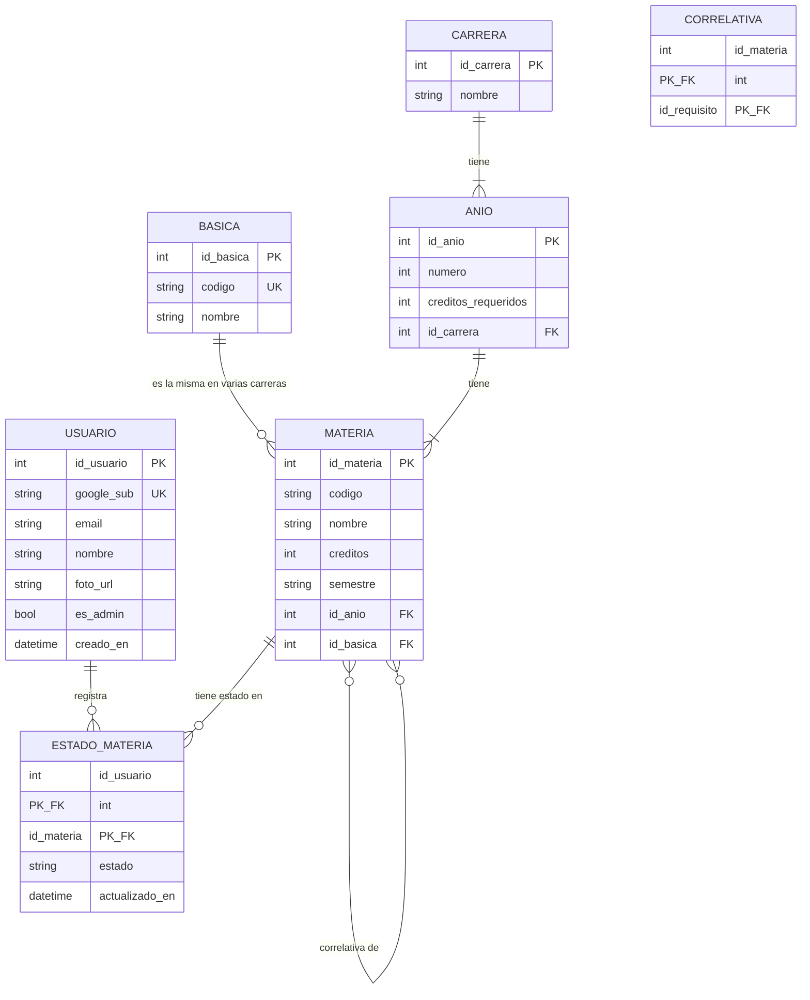

# Modelo de datos

El modelo representa el plan de estudios de una carrera universitaria y el
progreso de cada usuario sobre ese plan. Se compone de seis tablas:

- **Carrera**: la carrera universitaria (ej. Ingeniería en Informática).
- **Anio**: cada uno de los años que componen una carrera, con los créditos que
  hacen falta para poder cursarlo.
- **Materia**: cada materia de la carrera, que pertenece a un año.
- **Correlativa**: tabla de cruce que dice qué materias hay que aprobar antes de
  poder aprobar otra. Una materia puede tener **varias** correlativas.
- **Basica**: un grupo de materias que son **la misma** en varias ingenierías.
- **Usuario**: una cuenta de Google que sincronizó su progreso.
- **EstadoMateria**: el estado de cursado (`regular` o `aprobada`) de una materia
  **para un usuario**.

Los atributos marcados como `PK` son la clave primaria; los `FK` son claves
foráneas que referencian a otra tabla; `UK` es una restricción de unicidad.

> **Decisión importante**: el estado de cursado no es un atributo de la materia,
> sino de la relación entre un usuario y una materia. Si viviera en `materia`
> (como en la primera versión de este modelo), el progreso de un usuario se le
> pisaría a todos los demás.

## Entidades

### Carrera

| Columna      | Tipo    | Restricciones       | Descripción                       |
| ------------ | ------- | ------------------- | --------------------------------- |
| `id_carrera` | Integer | PK, autoincremental | Identificador único de la carrera |
| `nombre`     | String  | NOT NULL            | Nombre de la carrera              |

### Anio

| Columna               | Tipo    | Restricciones                       | Descripción                                                        |
| --------------------- | ------- | ----------------------------------- | ------------------------------------------------------------------ |
| `id_anio`             | Integer | PK, autoincremental                 | Identificador único del año                                        |
| `numero`              | Integer | NOT NULL                            | Número de año (1, 2, 3, ...)                                       |
| `creditos_requeridos` | Integer | NOT NULL                            | Créditos aprobados que hacen falta para tocar materias de este año |
| `id_carrera`          | Integer | FK → `carrera.id_carrera`, NOT NULL | Carrera a la que pertenece el año                                  |

### Materia

| Columna      | Tipo    | Restricciones                 | Descripción                                        |
| ------------ | ------- | ----------------------------- | -------------------------------------------------- |
| `id_materia` | Integer | PK, autoincremental           | Identificador único de la materia                  |
| `codigo`     | String  | NOT NULL, indexado            | Código del plan de estudios (ej. `0003`, `2022II`) |
| `nombre`     | String  | NOT NULL                      | Nombre de la materia                               |
| `creditos`   | Integer | NOT NULL                      | Créditos que otorga la materia una vez es aprobada |
| `semestre`   | String  | NOT NULL, CHECK (`1`,`2`,`anual`) | Semestre del año en que se cursa               |
| `id_basica`  | Integer | FK → `basica.id_basica`, NULL | Grupo de básicas, o NULL si es propia de la carrera |
| `id_anio`    | Integer | FK → `anio.id_anio`, NOT NULL | Año al que pertenece la materia                    |

El `semestre` se guarda como texto (`'1'`, `'2'` o `'anual'`) en lugar de un
entero con `NULL` para las anuales: un `NULL` con significado se lee mal. Las
materias anuales atraviesan los dos semestres, así que la malla las ubica
primero dentro de cada año (ver `ORDEN_SEMESTRE` en
`backend/src/models/materia.py`).

El `codigo` es el identificador que usan los planes de estudio de la facultad, y
es con lo que esos planes expresan las correlativas. Guardarlo permite que el
seed resuelva las correlativas por código en vez de por nombre. **No es único a
nivel global**: el mismo código aparece en varias carreras para las materias
básicas, y en este modelo cada carrera tiene su propia fila. La unicidad dentro
de una carrera la garantiza el script de carga.

### Basica

Las materias básicas (Química General, Cálculo I, Álgebra y Geometría
Analítica...) son **la misma materia** en todas las ingenierías que las tienen:
aprobarla en una cuenta en las demás.

| Columna     | Tipo    | Restricciones       | Descripción                                   |
| ----------- | ------- | ------------------- | --------------------------------------------- |
| `id_basica` | Integer | PK, autoincremental | Identificador del grupo                       |
| `codigo`    | String  | NOT NULL, UNIQUE    | Código del plan, el mismo en todas las carreras |
| `nombre`    | String  | NOT NULL            | Nombre de la materia                          |

Lo que se comparte es **el progreso**, no la materia: cada carrera conserva su
propia fila en `materia`, porque una básica puede estar en distinto año, con
distinto semestre, distintos créditos y distintas correlativas según el plan.

De ahí sale el caso incómodo: la misma materia puede ser alcanzable en una
carrera y no en otra. Cálculo I puede estar en 2º de Informática (12 créditos)
y en 3º de Industrial (38). **El progreso se propaga sólo donde el plan destino
queda consistente**, y lo que no se pudo propagar se informa en la respuesta de
la API en vez de hacerse en silencio. Rechazar el cambio entero castigaría al
usuario en la carrera que está mirando por culpa de otra que quizá ni cursa.

El agrupado lo hace `scripts/agrupar_basicas.py`, por código. Los códigos que
aparecen en varias carreras con nombres distintos **no se agrupan solos**: se
listan para revisión. En los planes de la UM pasa con el `5044`, que es
"Modelos y Simulación" en un plan y "Modelado y Sistemas de Control" en otro.

### Correlativa

Tabla de cruce auto-referencial sobre `materia`. Cada fila se lee como
"`id_materia` requiere tener aprobada `id_requisito`".

| Columna        | Tipo    | Restricciones                               | Descripción                 |
| -------------- | ------- | ------------------------------------------- | --------------------------- |
| `id_materia`   | Integer | PK compuesta, FK → `materia.id_materia`     | La materia que tiene el requisito |
| `id_requisito` | Integer | PK compuesta, FK → `materia.id_materia`     | La materia que hay que aprobar    |

Restricciones adicionales:

- `CHECK (id_materia != id_requisito)`: una materia no puede ser correlativa de
  sí misma.
- No se permiten **ciclos**: la API valida, antes de guardar, que las
  correlativas propuestas no hagan que una materia dependa de sí misma de forma
  transitiva. La validación vive en `backend/src/domain/correlativas.py`.
- `ON DELETE CASCADE` en ambas columnas: al borrar una materia desaparecen sus
  filas de correlativa.

### Usuario

| Columna      | Tipo     | Restricciones                | Descripción                                         |
| ------------ | -------- | ---------------------------- | --------------------------------------------------- |
| `id_usuario` | Integer  | PK, autoincremental          | Identificador único del usuario                     |
| `google_sub` | String   | NOT NULL, UNIQUE, indexado   | `sub` del ID token de Google: identificador estable |
| `email`      | String   | NOT NULL                     | Email de la cuenta                                  |
| `nombre`     | String   | NULL                         | Nombre para mostrar                                 |
| `foto_url`   | String   | NULL                         | Foto de perfil                                      |
| `es_admin`   | Boolean  | NOT NULL, default `false`    | Habilita los endpoints de carga de planes           |
| `creado_en`  | DateTime | NOT NULL                     | Fecha de alta                                       |

El identificador es `google_sub` y no el email, porque el email de una cuenta de
Google puede cambiar y el `sub` no.

### EstadoMateria

| Columna          | Tipo     | Restricciones                           | Descripción                          |
| ---------------- | -------- | --------------------------------------- | ------------------------------------ |
| `id_usuario`     | Integer  | PK compuesta, FK → `usuario.id_usuario` | Usuario dueño del estado             |
| `id_materia`     | Integer  | PK compuesta, FK → `materia.id_materia` | Materia a la que aplica              |
| `estado`         | String   | NOT NULL, CHECK (`regular`, `aprobada`) | Estado de cursado                    |
| `actualizado_en` | DateTime | NOT NULL                                | Última modificación, para el sync    |

La **ausencia de fila** significa "sin estado": no se guardan filas en null. Las
dos columnas tienen `ON DELETE CASCADE`, así que borrar un usuario o una materia
limpia sus estados.

## Relaciones

| Relación               | Cardinalidad | Descripción                                                                                      |
| ---------------------- | ------------ | ------------------------------------------------------------------------------------------------ |
| Carrera → Anio         | 1 : 1..\*    | Una carrera tiene uno o más años. Cada año pertenece a una sola carrera.                         |
| Anio → Materia         | 1 : 1..\*    | Un año tiene una o más materias. Cada materia pertenece a un solo año.                           |
| Materia ↔ Materia      | \* : \*      | Vía `correlativa`. Una materia puede tener N requisitos y ser requisito de N materias.           |
| Basica → Materia       | 1 : 0..\*    | Una básica agrupa las materias equivalentes de cada carrera.                                     |
| Usuario → EstadoMateria | 1 : 0..\*   | Un usuario tiene un estado por cada materia que marcó.                                           |
| Materia → EstadoMateria | 1 : 0..\*   | Una materia tiene un estado por cada usuario que la marcó.                                       |

## Notas y limitaciones conocidas

- **Las carreras comparten el progreso de las básicas, no las materias.** Cada
  carrera tiene su propia fila en `materia`; la tabla `basica` dice cuáles son
  la misma. Ver más arriba.
- **No hay electivas ni créditos libres.** Toda materia pertenece a un año y
  tiene créditos fijos.
- **No se guardan las horas.** Los planes traen horas semanales y totales por
  materia; el modelo sólo guarda los créditos, que son lo que la app usa.
- **La correlativa no distingue el tipo de requisito.** Una fila de
  `correlativa` siempre significa "hay que tenerla aprobada". No se modela
  "alcanza con tenerla regular".
- Los archivos `imgs/modelo datos.drawio` e `imgs/modelo_datos.png` corresponden
  a la **primera versión** del modelo y quedaron desactualizados; el diagrama
  vigente es el Mermaid de arriba.
